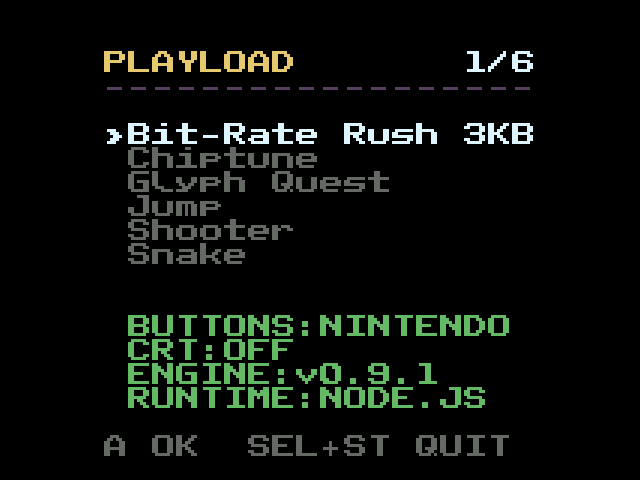
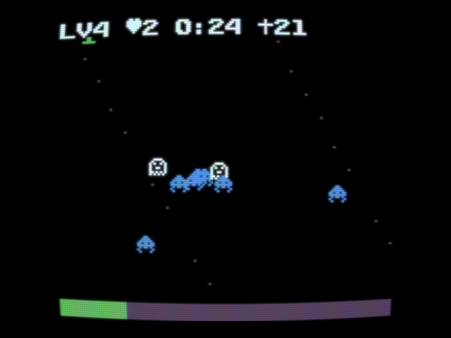
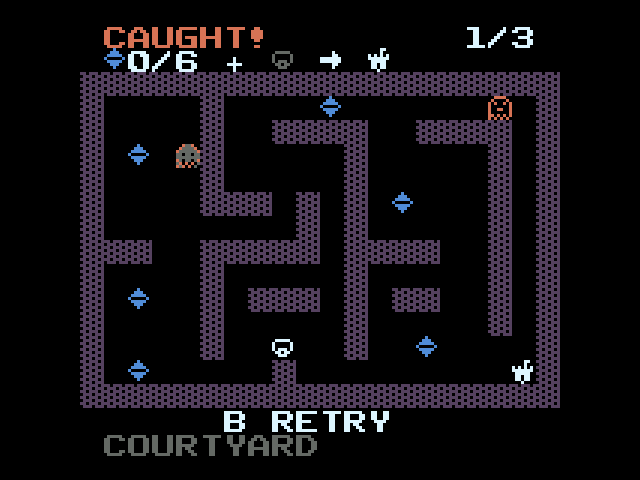
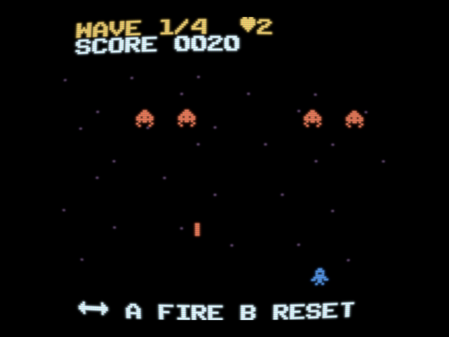
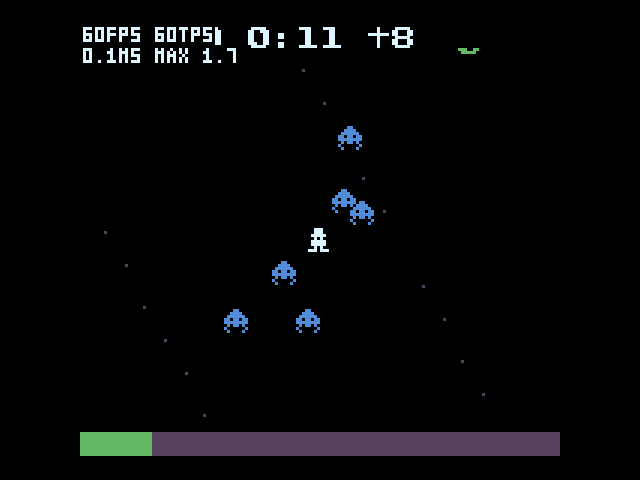

# Playload Handheld

**Play [Playload](https://github.com/kitao/playload) games on Linux handhelds, offline.**

[Playload](https://kitao.dev/playload/) is a tiny game engine by Takashi Kitao in which a whole game lives inside its URL. Playload Handheld is a PortMaster-style port for plumOS handhelds: save a game's URL as a `.url` file, copy it to the device, and play it with the device's buttons.

[日本語版はこちら](README.ja.md)

> Playload Handheld is an unofficial project. It is not affiliated with or endorsed by the Playload project or its author.

| Game menu | CRT view |
|---|---|
|  |  |
|  |  |

## Features

- Runs Playload game URLs at 60 fps on RK3566-class handhelds, including very heavy games.
- Uses Playload's own engine, so games look and sound the same as in the browser (frames and audio verified identical).
- Optional CRT view with Playload's own CRT shader.
- Game menu that remembers the last game you played.
- Button layout for Nintendo-style or Xbox-style devices.
- Updates the Playload engine from inside the app (Wi-Fi), with a self-test before switching.
- Performance overlay (FPS, ticks per second, frame time).

## Supported devices

Tested on plumOS:

| Device | SoC | Recommended setting | Heavy games* |
|---|---|---|---|
| plumOS-Bubble | Rockchip RK3566 | CRT on or off | 60 fps |
| GameKiddy GKD Pixel2 | Rockchip RK3326 | CRT **off** | 30–54 fps |
| V90S | Allwinner A133P | CRT **off** | ~59 fps (the screen's limit) |

\*AFTER LOAD HD and rubble., two of the heaviest Playload games we know of. Ordinary games run at full speed on all three. See [docs/BENCHMARKS.md](docs/BENCHMARKS.md).

Other 64-bit ARM Linux handhelds with PortMaster may work but are untested.

## Installation

1. Download `playload-handheld-<version>.zip` from [Releases](../../releases).
2. Extract it into your device's ports folder, so that `Playload.sh` and the `playload` folder sit side by side:

   | plumOS variant | Ports folder |
   |---|---|
   | Bubble | `Roms/PORTS/` on the SD card (`/storage/user/Roms/PORTS/`) |
   | Pixel2 | `PORTS/` on the ROMS card (`/roms/PORTS/`) |
   | V90S | `roms/ports/` on the SD card (`/mnt/plumos/roms/ports/`) |

3. Start **Playload** from the PORTS section of the frontend.

To update, extract a newer zip over the old one. Your settings, games and downloaded engines are kept.

## Adding games

A Playload game *is* its URL. To add one:

1. Open the game in a browser and copy the **full address** from the address bar. It starts with `https://kitao.dev/playload/app/#v1.` and is long.
   - Links in posts on X are shortened (`https://t.co/…`) and do not contain the game. Open the link first, then copy the address the browser shows.
2. Paste it into a text file and save it as `<any name>.url` (one line is enough).
3. Copy the file to `playload/games/` on the device.

The menu shows the game's own title (its `// @title` line), not the file name. Plain JavaScript files (`.js`) of Playload games work too.

## Controls

| Button | In games | In the menu |
|---|---|---|
| D-pad / left stick | Playload's arrows | Move (hold to repeat); left/right turn a page in the game list |
| A | Playload's A | Play a game / change a setting |
| B | Playload's B | — |
| SELECT + START | Back to the menu | Quit |
| SELECT + R1 | Toggle the CRT view | Toggle the CRT view |
| SELECT + L1 | Toggle the performance overlay | Toggle the performance overlay |

The menu opens on the game you played last.

## Settings

The last rows of the menu are settings. Pick one with up/down and change it with A or left/right. They are saved in `playload/playload.cfg`.

| Setting | Values | |
|---|---|---|
| `BUTTONS` | `NINTENDO` / `XBOX` | Swaps A and B. Pick the one that matches the labels on your device. |
| `CRT` | `ON` / `OFF` | Playload's CRT view. Recommended off on RK3326 and A133P. |
| `ENGINE` | `builtin` / downloaded versions | **A**: check GitHub for a newer Playload release, test it and switch to it. **Left/right**: switch between installed versions. |
| `RUNTIME` | `NODE.JS` / `QUICKJS` | Which JavaScript engine runs games. Node.js is much faster; QuickJS is used automatically if Node.js cannot start. |

### Performance overlay

SELECT + L1 shows two lines in the top-left corner:



- `60FPS`: screen updates per second.
- `60TPS`: game ticks per second. Below 60, the game itself slows down.
- `0.1MS MAX 1.7`: average and longest time the player waited for a tick in the last second.

Node.js needs a few seconds after a game starts to optimize it, so a short hitch right after starting is normal.

## Files

```
Playload.sh                 launch script (PORTS folder)
playload/
├── playload.aarch64        the player
├── games/                  your .url files
├── playload.cfg            settings (created on first change)
├── engine/<version>/       Playload engines downloaded by the in-app update
├── node/                   Node.js, its libraries, and the built-in engine
├── licenses/               license texts and third-party notices
└── log.txt                 log of the last run (for troubleshooting)
```

## Troubleshooting

- **A game shows ERROR**: the message on screen and `playload/log.txt` say why. Games made for a newer Playload may need a newer engine: select `ENGINE` and press A.
- **Engine update says NO CONNECTION**: connect the device to Wi-Fi first.
- **Low frame rate**: turn the CRT view off (SELECT + R1), and check that `RUNTIME` is `NODE.JS`.
- **A and B are swapped**: change `BUTTONS` in the menu.

## For developers

Architecture, specifications, the performance work behind the player, and how to build and package it: [docs/DEVELOPMENT.md](docs/DEVELOPMENT.md).

## License

Playload Handheld is released under the [MIT License](LICENSE). It includes Playload (MIT), QuickJS-ng (MIT), and in the release archive Node.js (MIT) and GNU libraries from Debian (LGPL / GPL with the GCC Runtime Library Exception). See [THIRD_PARTY_NOTICES.md](THIRD_PARTY_NOTICES.md).

Thanks to Takashi Kitao for Playload.
